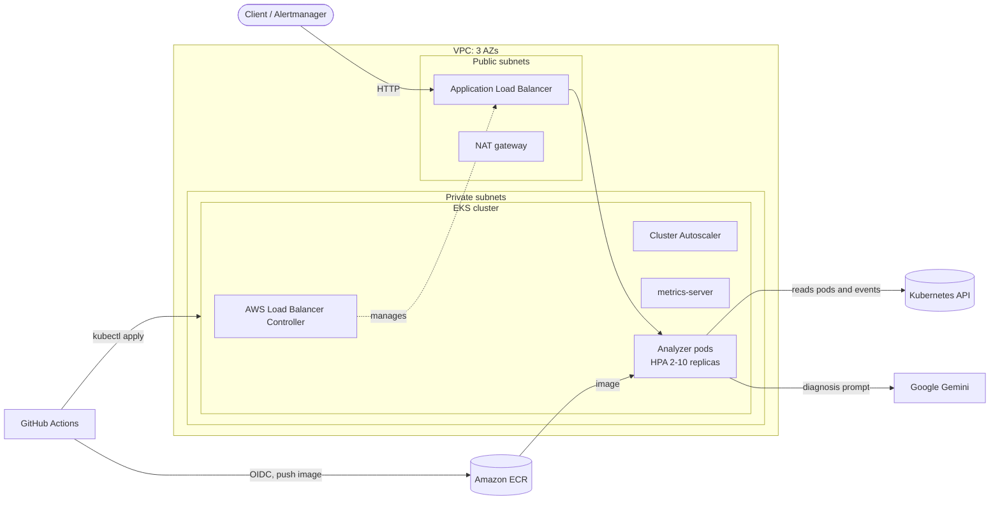

# AIOps on Amazon EKS

[](https://github.com/ADITYA-WORK-MAITI/aiops-eks-terraform/actions/workflows/ci.yml)

Terraform provisions a scalable Amazon EKS cluster with the AWS Load Balancer Controller
(ALB Ingress). An AI-assisted incident analyzer runs on that cluster. The analyzer collects
failure signals from Kubernetes, such as crash-looping pods, OOM kills, scheduling failures
and warning events. It sends them to Google Gemini, which returns a probable root cause and
remediation steps. If Gemini is not configured or does not respond, a built-in rule engine
gives the diagnosis instead.

## Architecture



## What gets provisioned

| Layer | Resources |
|---|---|
| Network | VPC across 2-3 AZs, public subnets for load balancers, private subnets for nodes, NAT gateway, subnet tags for ALB discovery |
| Cluster | EKS control plane, managed node group (on-demand or spot), core add-ons (VPC CNI, CoreDNS, kube-proxy), access entries |
| Scaling | Cluster Autoscaler (nodes), metrics-server and HorizontalPodAutoscaler (pods) |
| Ingress | AWS Load Balancer Controller, which turns Kubernetes `Ingress` objects into ALBs |
| IAM | IRSA roles for each controller, scoped by service account. An optional GitHub OIDC role lets CI deploy without long-lived keys |
| Registry | ECR repository with immutable tags, scan on push and a lifecycle policy |

The VPC and EKS layers use the community `terraform-aws-modules`. Add-ons, IAM, ECR and the
CI role are defined directly in this repository.

## Repository layout

```
.
├── terraform/            # Infrastructure as code
│   ├── vpc.tf            #   networking
│   ├── eks.tf            #   cluster and node group
│   ├── addons.tf         #   ALB controller, Cluster Autoscaler, metrics-server (Helm + IRSA)
│   ├── ecr.tf            #   container registry
│   └── github-oidc.tf    #   CI deploy role
├── app/                  # AIOps analyzer (Python, FastAPI)
│   ├── aiops/
│   │   ├── collector.py  #   turns pod status and events into signals
│   │   ├── analyzer.py   #   Gemini analyzer with rule-based fallback
│   │   └── main.py       #   HTTP API
│   ├── tests/
│   └── Dockerfile
├── k8s/                  # Kustomize manifests: Deployment, Service, Ingress, HPA, RBAC
└── .github/workflows/    # CI (lint, test, validate, build) and deploy to EKS
```

## The analyzer

| Endpoint | Purpose |
|---|---|
| `GET /cluster/report` | Scans every namespace for unhealthy pods and warning events, then diagnoses them |
| `POST /analyze` | Diagnoses signals supplied in the request body |
| `POST /alerts/alertmanager` | Webhook receiver for Prometheus Alertmanager |
| `GET /healthz` | Liveness and readiness probe |

The collector reports a symptom's real cause where Kubernetes records it. For example, a
container in `CrashLoopBackOff` whose last exit was `OOMKilled` is reported as an OOM
problem. Signals are deduplicated before analysis.

Example:

```bash
curl -s http://<alb-dns>/analyze -H 'Content-Type: application/json' -d '{
  "signals": [{"source": "pod", "namespace": "shop", "resource": "pod/cart-7d9f/app",
               "reason": "OOMKilled", "message": "exit code 137", "count": 6}]
}'
```

```json
{
  "summary": "The cart container is repeatedly killed for exceeding its memory limit.",
  "findings": [{
    "resource": "pod/cart-7d9f/app",
    "severity": "critical",
    "category": "resources",
    "root_cause": "Memory usage exceeds the 256Mi limit under load ...",
    "remediation": ["kubectl top pod -n shop", "Raise resources.limits.memory ..."]
  }],
  "engine": "gemini"
}
```

The analyzer only has read access to pods and events (`k8s/rbac.yaml`). It runs as a
non-root user with a read-only root filesystem, under the `restricted` Pod Security Standard.

## Getting started

### Prerequisites

- AWS account and credentials with permission to create VPC, EKS, IAM and ECR resources
- Terraform >= 1.10, AWS CLI v2, kubectl, Docker
- An S3 bucket for Terraform state
- A Gemini API key (optional; without it the rule engine is used)

### 1. Provision the infrastructure

```bash
cd terraform
cp backend.hcl.example backend.hcl            # set your state bucket
cp terraform.tfvars.example terraform.tfvars  # adjust region, sizes, repository

terraform init -backend-config=backend.hcl
terraform apply
$(terraform output -raw configure_kubectl)
```

### 2. Deploy the analyzer

```bash
ECR=$(terraform -chdir=terraform output -raw ecr_repository_url)
REGION=$(terraform -chdir=terraform output -raw region)
aws ecr get-login-password --region "$REGION" | docker login --username AWS --password-stdin "${ECR%%/*}"
docker build -t "$ECR:v1" app && docker push "$ECR:v1"

kubectl create namespace aiops
kubectl -n aiops create secret generic gemini --from-literal=api-key=<GEMINI_API_KEY>

(cd k8s && kustomize edit set image analyzer="$ECR:v1")
kubectl apply -k k8s
kubectl -n aiops get ingress analyzer   # ALB address appears after 1-2 minutes
```

### 3. Continuous deployment (optional)

Set `github_repository` in `terraform.tfvars` and apply. Then add these repository variables
under *Settings → Secrets and variables → Actions → Variables*:

| Variable | Value |
|---|---|
| `AWS_DEPLOY_ROLE_ARN` | `terraform output github_deploy_role_arn` |
| `AWS_REGION` | `terraform output region` |
| `EKS_CLUSTER_NAME` | `terraform output cluster_name` |

After that, every push to `main` that changes `app/` or `k8s/` builds the image, pushes it to
ECR with the commit SHA as tag, and rolls it out. Until the variables are set, the deploy
job is skipped.

## CI

Every push and pull request runs these checks. None of them need AWS credentials.

- **App:** `ruff` lint and format check, `pytest` unit tests (the Kubernetes API and Gemini are mocked)
- **Terraform:** `fmt -check` and `validate`
- **Manifests:** rendered with Kustomize and validated against the Kubernetes 1.33 schemas with `kubeconform`
- **Image:** Docker build

Run them locally with `make lint test tf-validate manifests`.

## Cost and teardown

The default configuration runs one EKS control plane, two `t3.medium` nodes, one NAT gateway
and one ALB. All of these are billed by the hour. Set `node_capacity_type = "SPOT"` to cut
node cost.

Delete the Ingress before destroying the infrastructure. The ALB is created by the
controller, not by Terraform, and a leftover ALB blocks VPC deletion.

```bash
kubectl delete -k k8s
terraform -chdir=terraform destroy
```

## License

[MIT](LICENSE)
